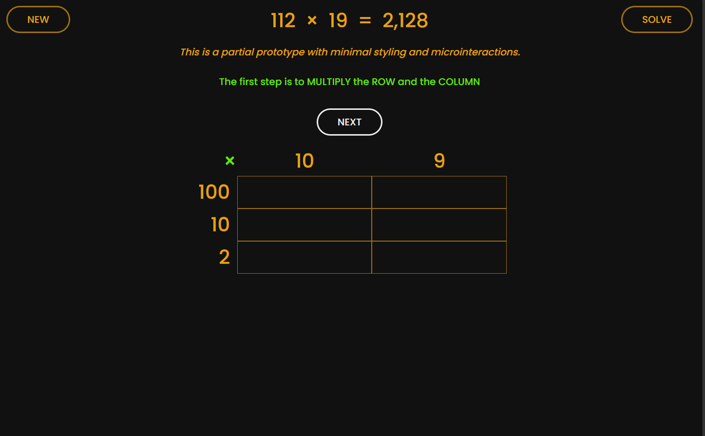
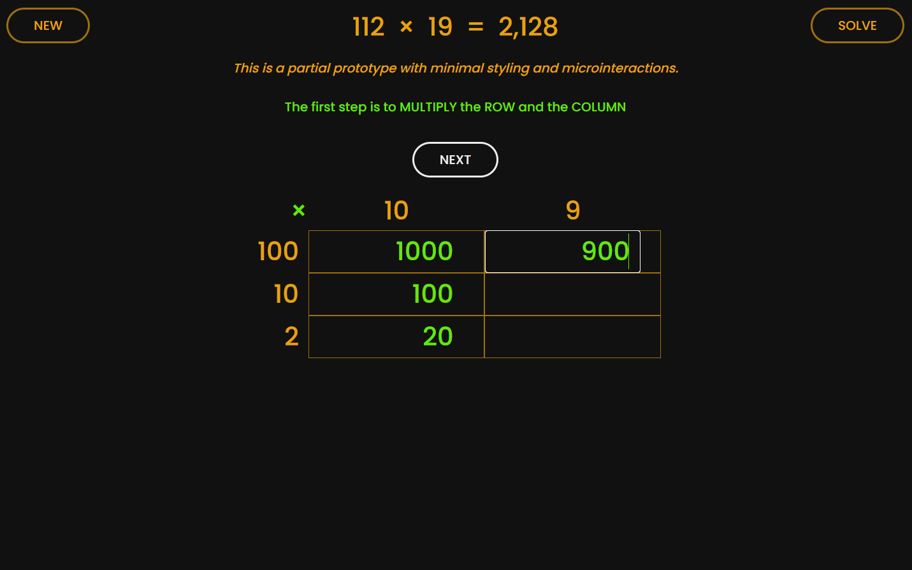
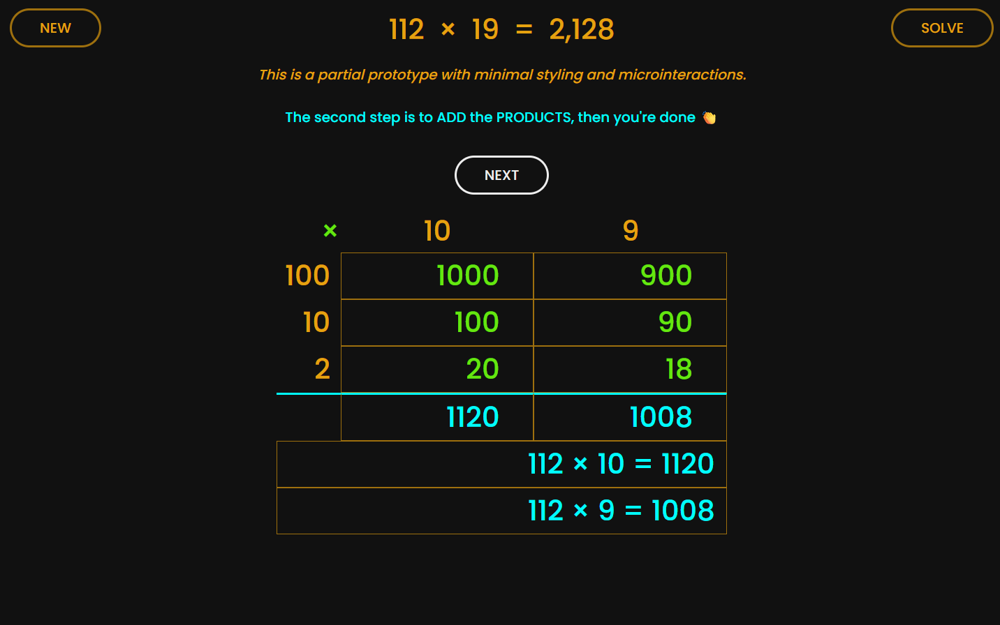

# Interactive Area Models

An educational web application that helps students develop conceptual understanding of multiplication through dynamic, step-by-step area models.

🔗 Live Demo: https://area-models.netlify.app/

## Overview

Interactive Area Models guides students through the area model multiplication process by breaking factors into place-value components, generating partial products, and visualizing how those products combine to form a final solution.

Rather than focusing solely on procedural fluency, the application emphasizes mathematical reasoning, place value understanding, and visual connections between multiplication and area.

## Features

- Randomly generated multiplication problems
- Step-by-step guided instruction
- Automatic factor decomposition
- Dynamic area model visualization
- Partial product calculation
- Interactive student input
- Solution review and verification
- Responsive browser-based interface

## Screenshots

### Initial Problem

Students begin with a multiplication problem and a decomposed area model scaffold.

The factors are broken into place-value components, helping students visualize the structure of the multiplication problem before solving.

---

### Partial Products

Students calculate the products for each region of the area model.

The visual model reinforces the distributive property by showing how each row and column combine to create individual partial products.

---

### Final Solution

Partial products are combined to produce the final result.

Students can see how the individual products contribute to the overall solution, strengthening conceptual understanding of multiplication.

---

## Mathematical Concepts

The application supports instruction related to:

- Area Models
- Place Value
- Multi-Digit Multiplication
- Partial Products
- Distributive Property
- Number Sense
- Mathematical Reasoning
- Visual Representations
- Problem Solving

## Educational Purpose

This project was developed to make abstract multiplication concepts more accessible through visualization and interaction. The instructional sequence encourages students to:

1. Decompose numbers by place value.
2. Calculate partial products.
3. Analyze relationships between factors.
4. Connect visual and symbolic representations.
5. Verify solutions through reasoning.

## Technology Stack

- HTML5
- CSS3
- JavaScript

## Future Enhancements

- Fraction area models
- Decimal multiplication models
- Algebra tiles integration
- Teacher dashboard
- Student progress tracking
- Accessibility improvements
- Additional instructional scaffolding
- Expanded visual customization

## Author

**Matthew Lorber**

Mathematics & Computer Science Educator  
FIRST Robotics Mentor  
UIL Computer Science Coach

GitHub: https://github.com/mlorberdev

# License

[CC BY 4.0](https://creativecommons.org/licenses/by/4.0/)
